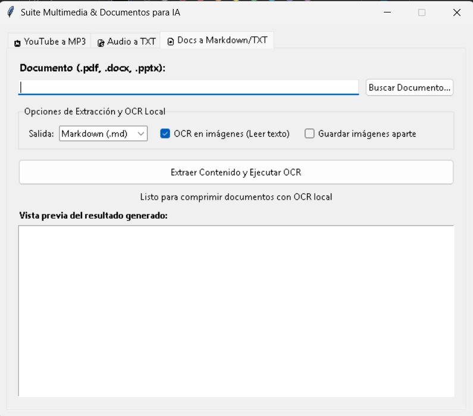

# Media & Doc AI Suite (YouTube MP3, Whisper STT y OCR)

Aplicación de escritorio desarrollada en Python con interfaz gráfica (`Tkinter`) que centraliza tres herramientas de procesamiento multimedia y documental. La transcripción y el OCR se ejecutan localmente; la descarga desde YouTube y la primera descarga de pesos de modelos Whisper requieren acceso a red.




## Características principales

1. **Descargador de YouTube a MP3:**
   - Extracción de audio mediante `yt-dlp` y `FFmpeg`.
   - Recorte opcional por rango de tiempo (`SS`, `MM:SS` o `HH:MM:SS`) sin descargar el archivo completo cuando se especifica un intervalo.
   - Selección de tasa de bits (`64` a `320 kbps`).

2. **Transcriptor de audio a texto (Speech-to-Text local):**
   - Impulsado por `faster-whisper` (cuantización `int8` en CPU).
   - Soporte para notas de voz de WhatsApp (`.opus`, `.ogg`), `.mp3`, `.wav`, `.m4a`, `.aac`, `.flac` y `.mp4`.
   - Opción de marcas de tiempo por segmento y selección de tamaño de modelo (`tiny`, `base`, `small`, `medium`).

3. **Extractor de documentos a Markdown con OCR:**
   - Convierte archivos `.pdf`, `.docx` y `.pptx` a Markdown estructurado (`.md`).
   - Reconstruye tablas en sintaxis Markdown (en PDF, Word y PowerPoint) y extrae notas del orador.
   - **OCR local (`RapidOCR`):** Detecta y transcribe texto incrustado dentro de imágenes, capturas y diagramas.

## Requisitos previos

- **Python 3.10 o superior**
- **FFmpeg** instalado y configurado en el `PATH` del sistema:
  - Windows: `winget install Gyan.FFmpeg`
  - Linux (Debian/Ubuntu): `sudo apt install ffmpeg python3-tk -y`

## Instalación y uso

1. Clona este repositorio:
   ```bash
   git clone https://github.com/ClasK7/media-doc-ai-suite.git
   cd media-doc-ai-suite
   ```

2. **(Opcional)** Crea y activa un entorno virtual:

   ```bash
   python -m venv venv
   # En Windows:
   venv\Scripts\activate
   # En Linux/macOS:
   source venv/bin/activate
   ```

3. Instala las dependencias:

   ```bash
   pip install -r requirements.txt
   ```

4. Ejecuta la aplicación:

   ```bash
   python main.py
   ```

## Pruebas unitarias

```bash
python -m unittest discover -s tests -v
```
