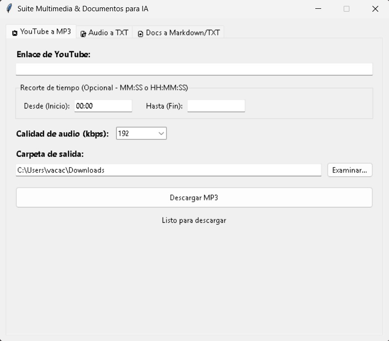
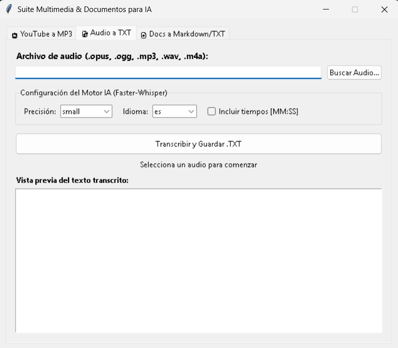

# Media & Doc AI Suite (YouTube MP3, Whisper STT & OCR)

Aplicación de escritorio desarrollada en Python con interfaz gráfica (`Tkinter`) que centraliza tres herramientas locales de procesamiento multimedia y documental sin depender de servicios web externos ni consumo innecesario de tokens en LLMs.






## Características Principales

1. **Descargador de YouTube a MP3:**
   - Extracción de audio de alta fidelidad mediante `yt-dlp` y `FFmpeg`.
   - Recorte preciso por rango de tiempo (`MM:SS` o `HH:MM:SS`) sin descargar el archivo completo.
   - Selección de tasa de bits (`64` a `320 kbps`).

2. **Transcriptor de Audio a Texto (Speech-to-Text Local):**
   - Impulsado por `faster-whisper` (cuantización `int8` optimizada para CPU).
   - Soporte nativo para notas de voz de WhatsApp (`.opus`, `.ogg`), `.mp3`, `.wav` y `.m4a`.
   - Opción de marcas de tiempo por segmento y selección de modelo (`tiny`, `base`, `small`, `medium`).

3. **Extractor de Documentos a Markdown/TXT con OCR:**
   - Convierte archivos `.pdf`, `.docx` y `.pptx` a Markdown estructurado para optimizar el contexto en modelos de IA.
   - Reconstruye tablas en sintaxis Markdown y extrae notas del orador.
   - **OCR Local (`RapidOCR`):** Detecta y transcribe automáticamente texto incrustado dentro de imágenes, capturas y diagramas.

## Requisitos Previos

- **Python 3.10 o superior**
- **FFmpeg** instalado y configurado en el `PATH` del sistema:
  - Windows: `winget install Gyan.FFmpeg`
  - Linux (Debian/Ubuntu): `sudo apt install ffmpeg -y`

## Instalación y Uso

1. Clona este repositorio:
   ```bash
   git clone [https://github.com/ClasK7/media-doc-ai-suite.git](https://github.com/ClasK7/media-doc-ai-suite.git)
   cd media-doc-ai-suite
   ```

2. **(Opcional recomendado)** Crea y activa un entorno virtual:

   ```bash
   python -m venv venv
   # En Windows:
   venv\Scripts\activate
   # En Linux/macOS:
   source venv/bin/activate
   ```
3. Instala las dependencias:

    ```bash
    pip install -r requirements.txt
    ```
4. Ejecuta la aplicación:
    ```bash
    python main.py
    ```